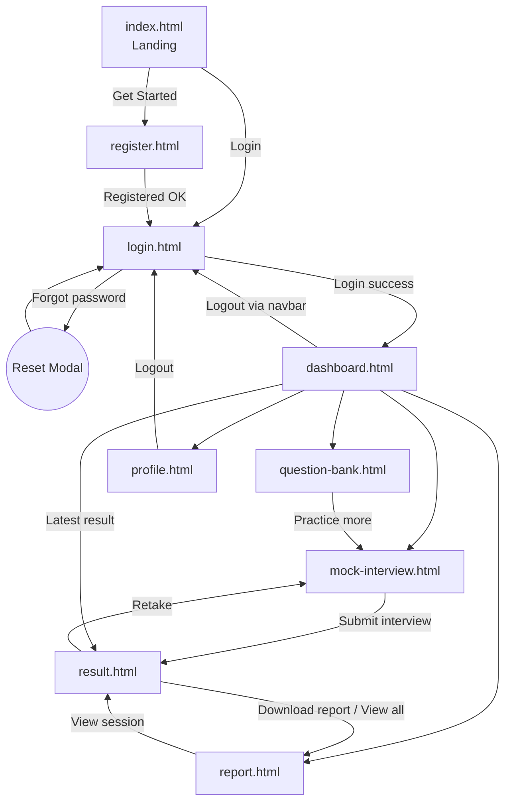

# Frontend.md — Crack My Interview

> **Practice Smart. Perform Better. Get Hired.**
> Frontend specification for the *Crack My Interview* interview preparation platform.
> Derived from the project SRS v1.0 (Modules: Authentication, Question Bank, Mock Interview, Evaluation & Feedback, Performance Report).

---

## 1. Overview

| Item | Value |
|---|---|
| Project | Crack My Interview |
| Frontend Tech | **HTML5, CSS3, Vanilla JavaScript only** (no React, no frameworks) |
| Backend (reference) | Python Flask (REST API, JSON) |
| Database (reference) | SQLite |
| Charts | Chart.js via CDN (the only allowed external library) |
| Icons | Inline SVG or Font Awesome CDN |
| Font | `Poppins` (headings) + `Inter` (body), with `system-ui, sans-serif` fallback |
| Browsers | Latest Chrome, Edge, Firefox, Safari |
| Design Keywords | Dark Blue Header · White Background · Orange Buttons · Card Layout · Mobile Responsive · Same Navbar on every page |

### 1.1 Goals
- Clean, consistent, student-friendly UI.
- One shared navbar and footer on all 9 pages.
- Fully responsive: 320px phones → 1440px+ desktops.
- Frontend talks to Flask only through `fetch()` calls to `/api/...`.
- Accessible: semantic HTML, labels on every input, visible focus states, AA colour contrast.

### 1.2 Pages

| # | File | Purpose | Auth Required |
|---|---|---|---|
| 1 | `index.html` | Landing / home page | No |
| 2 | `register.html` | Create account | No |
| 3 | `login.html` | Sign in (includes Forgot Password modal) | No |
| 4 | `dashboard.html` | Hub to all modules + quick stats | Yes |
| 5 | `profile.html` | View/update profile, change password | Yes |
| 6 | `question-bank.html` | Browse + filter questions (admin controls shown for admin role) | Yes |
| 7 | `mock-interview.html` | Setup → timed one-by-one interview | Yes |
| 8 | `result.html` | Evaluation: score, answers, strengths, weaknesses, suggestions | Yes |
| 9 | `report.html` | History, graphs, summary, report download | Yes |

---

## 2. Project Structure

```
crack-my-interview/
├── index.html
├── register.html
├── login.html
├── dashboard.html
├── profile.html
├── question-bank.html
├── mock-interview.html
├── result.html
├── report.html
│
├── css/
│   ├── variables.css      /* colour tokens, spacing, radius, shadows */
│   ├── base.css           /* reset, typography, utilities */
│   ├── components.css     /* navbar, buttons, cards, forms, badges, modal, toast */
│   ├── layout.css         /* grid, containers, responsive breakpoints */
│   └── pages.css          /* page-specific styles */
│
├── js/
│   ├── config.js          /* API_BASE, constants */
│   ├── api.js             /* fetch wrapper + endpoint functions */
│   ├── auth.js            /* session check, login/logout, route guard */
│   ├── navbar.js          /* injects shared navbar + footer into every page */
│   ├── ui.js              /* toast, modal, loader, validators */
│   ├── dashboard.js
│   ├── profile.js
│   ├── question-bank.js
│   ├── mock-interview.js
│   ├── result.js
│   └── report.js
│
└── assets/
    ├── logo.svg
    ├── favicon.ico
    └── images/
```

**Shared-navbar rule:** every page contains `<div id="navbar-root"></div>` and `<div id="footer-root"></div>`; `navbar.js` renders them. This guarantees the navbar is identical on all pages. Only the `active` link changes (based on `location.pathname`).

---

## 3. Design System

### 3.1 Colour Codes

| Token | Hex | Usage |
|---|---|---|
| `--navy-900` | `#0A1F44` | **Header / navbar background**, footer |
| `--navy-700` | `#13306B` | Header hover states, dark sections |
| `--navy-500` | `#1F4DA8` | Links, focus ring, chart line |
| `--orange-500` | `#FF7A00` | **Primary buttons**, highlights, active underline |
| `--orange-600` | `#E56A00` | Button hover |
| `--orange-700` | `#C25A00` | Button active/pressed |
| `--orange-100` | `#FFF1E3` | Soft orange tint (badges, hover rows) |
| `--white` | `#FFFFFF` | **Page background**, cards |
| `--gray-50` | `#F6F8FB` | Section background, table stripe |
| `--gray-100` | `#EEF1F6` | Borders, dividers |
| `--gray-300` | `#CBD3E1` | Input borders |
| `--gray-500` | `#6B7280` | Muted text |
| `--gray-900` | `#111827` | Body text |
| `--success` | `#16A34A` | Correct answer, high score |
| `--success-bg` | `#E8F7EE` | Correct background |
| `--danger` | `#DC2626` | Incorrect answer, errors |
| `--danger-bg` | `#FDECEC` | Error background |
| `--warning` | `#F59E0B` | Timer low warning, unanswered |
| `--info` | `#2563EB` | Info toast |

```css
:root {
  --navy-900:#0A1F44; --navy-700:#13306B; --navy-500:#1F4DA8;
  --orange-500:#FF7A00; --orange-600:#E56A00; --orange-700:#C25A00; --orange-100:#FFF1E3;
  --white:#FFFFFF; --gray-50:#F6F8FB; --gray-100:#EEF1F6; --gray-300:#CBD3E1;
  --gray-500:#6B7280; --gray-900:#111827;
  --success:#16A34A; --success-bg:#E8F7EE;
  --danger:#DC2626;  --danger-bg:#FDECEC;
  --warning:#F59E0B; --info:#2563EB;

  --radius-sm:6px; --radius-md:12px; --radius-lg:18px;
  --shadow-card:0 2px 8px rgba(10,31,68,.08);
  --shadow-hover:0 8px 24px rgba(10,31,68,.14);
  --container:1200px;
}
```

> **Contrast note:** White text on `#FF7A00` is ~2.9:1. Use **bold 16px+ text** on orange buttons, or use `--navy-900` text on orange for strict AA compliance. Pick one and keep it consistent across all pages.

### 3.2 Typography

| Element | Font | Size (desktop / mobile) | Weight |
|---|---|---|---|
| H1 | Poppins | 44px / 30px | 700 |
| H2 | Poppins | 32px / 24px | 600 |
| H3 | Poppins | 22px / 18px | 600 |
| Body | Inter | 16px / 15px | 400 |
| Small / caption | Inter | 14px / 13px | 400 |
| Button | Inter | 16px | 600 |

### 3.3 Spacing, Radius, Shadow
- Spacing scale: `4 · 8 · 12 · 16 · 24 · 32 · 48 · 64` px.
- Card radius `12px`, button radius `8px`, pill/badge radius `999px`.
- Card shadow `--shadow-card`; on hover `--shadow-hover` + `translateY(-2px)`.
- Container: `max-width: 1200px; margin: 0 auto; padding: 0 16px`.

### 3.4 Responsive Breakpoints

| Name | Width | Behaviour |
|---|---|---|
| Mobile | `≤ 575px` | 1 column, hamburger menu, full-width buttons |
| Tablet | `576–991px` | 2 columns, hamburger menu |
| Desktop | `≥ 992px` | 3–4 columns, full horizontal navbar |
| Large | `≥ 1400px` | Container capped at 1200px |

Approach: **mobile-first** (`min-width` media queries), CSS Grid + Flexbox.

---

## 4. Shared Components

### 4.1 Navbar (identical on all 9 pages)

**Style:** background `--navy-900`, height `64px`, sticky top, white text, subtle bottom shadow.

**Layout (desktop):**
```
[ 🎯 Crack My Interview ]   Home  Dashboard  Question Bank  Mock Interview  Reports      [ Profile ▾ ]
```

| Slot | Logged OUT | Logged IN |
|---|---|---|
| Left | Logo + brand name → `index.html` | Logo + brand name → `dashboard.html` |
| Centre links | Home | Home · Dashboard · Question Bank · Mock Interview · Reports |
| Right | `Login` (outline) · `Register` (orange) | Avatar + first name dropdown → **Profile**, **Logout** |

**Behaviour**
- Active link: orange `3px` bottom border + orange text.
- Link hover: `--navy-700` background.
- Below `992px`: links collapse into a hamburger (☰) that opens a slide-down panel; the Profile/Logout items move into the panel.
- Navbar links when logged out redirect protected pages to `login.html`.
- **Logout** → clears session → redirects to `login.html` (FR-05).

**HTML skeleton**
```html
<header class="navbar">
  <div class="container nav-inner">
    <a href="index.html" class="brand">Crack My Interview</a>
    <button class="nav-toggle" aria-label="Toggle menu" aria-expanded="false">☰</button>
    <nav class="nav-links" id="nav-links">
      <a href="index.html">Home</a>
      <a href="dashboard.html">Dashboard</a>
      <a href="question-bank.html">Question Bank</a>
      <a href="mock-interview.html">Mock Interview</a>
      <a href="report.html">Reports</a>
    </nav>
    <div class="nav-auth"><!-- Login/Register OR user dropdown --></div>
  </div>
</header>
```

### 4.2 Footer (shared)
- Background `--navy-900`, text `--gray-300`, `32px` padding.
- Content: brand + tagline, quick links (Home, Question Bank, Mock Interview), "© 2026 Crack My Interview — College Project".
- Stacks to 1 column on mobile.

### 4.3 Buttons

| Variant | Class | Style |
|---|---|---|
| Primary (default) | `.btn .btn-primary` | Bg `--orange-500`, text white/bold, hover `--orange-600`, active `--orange-700` |
| Outline | `.btn-outline` | Transparent bg, `2px` orange border + orange text; hover fills orange |
| Secondary | `.btn-secondary` | Bg `--navy-900`, white text |
| Ghost / light | `.btn-ghost` | Transparent, white text (used on navy header) |
| Danger | `.btn-danger` | Bg `--danger`, white text |
| Sizes | `.btn-sm / .btn-lg / .btn-block` | 36 / 52 px height / 100% width |

States: `:hover`, `:focus-visible` (3px `--navy-500` ring), `:disabled` (50% opacity, `not-allowed`), `.loading` (spinner + disabled).

### 4.4 Cards
- White bg, `1px solid --gray-100`, radius `12px`, padding `24px`, `--shadow-card`.
- Variants: **Stat card** (big number + label + icon), **Module card** (icon, title, text, CTA), **Question card**, **Auth card** (max-width 440px, centred), **Result card**.
- Card grid: `display:grid; grid-template-columns: repeat(auto-fit, minmax(260px, 1fr)); gap:24px`.

### 4.5 Form Controls
- Label above input, `14px`, weight 600.
- Input: height `44px`, border `1px --gray-300`, radius `8px`, padding `0 12px`; focus → border `--navy-500` + `0 0 0 3px rgba(31,77,168,.2)`.
- Error state: border `--danger`, helper text in red below input.
- Password field has a show/hide eye toggle.
- Select, radio-group (pill style), checkbox, textarea (for coding/descriptive answers, monospace for coding).

### 4.6 Badges / Chips
| Badge | Colours |
|---|---|
| Category: HR | bg `#E0ECFF` / text `#1F4DA8` |
| Category: Technical | bg `#EDE7FF` / text `#5B34C9` |
| Category: Aptitude | bg `#E6F7F1` / text `#0F7B5A` |
| Category: Coding | bg `#FFF1E3` / text `#C25A00` |
| Difficulty: Beginner | bg `--success-bg` / text `--success` |
| Difficulty: Intermediate | bg `#FEF3C7` / text `#B45309` |
| Difficulty: Advanced | bg `--danger-bg` / text `--danger` |

### 4.7 Alerts, Toasts, Modal, Loader
- **Alert (inline):** success / error / info / warning; tinted bg + left `4px` border.
- **Toast:** top-right (bottom on mobile), auto-dismiss 4s, `role="status"`.
- **Modal:** centred card, dark overlay `rgba(10,31,68,.6)`, closes on ESC / overlay click. Used for Forgot Password, Delete confirm, Quit-interview confirm.
- **Loader:** orange spinner; skeleton shimmer for cards/tables while fetching.
- **Empty state:** icon + message + CTA (e.g., "No interviews yet — Start your first mock interview").

### 4.8 Progress Bar & Timer
- Progress bar: track `--gray-100`, fill `--orange-500`, height `10px`, radius pill.
- Timer chip: navy bg, white monospace `MM:SS`; turns `--warning` at ≤ 30s, `--danger` + pulse at ≤ 10s.

### 4.9 Table
- Header row `--navy-900` bg + white text; zebra rows `--gray-50`; row hover `--orange-100`.
- On `≤ 575px` the table converts to stacked cards (`data-label` pattern) — no horizontal page scroll.

### 4.10 Charts (Chart.js)
- Line chart: score trend (colour `--navy-500`, point `--orange-500`).
- Bar chart: category-wise average (use the category badge colours).
- Doughnut: correct / incorrect / unanswered (`--success`, `--danger`, `--warning`).
- Always `responsive: true; maintainAspectRatio: false` inside a fixed-height wrapper.

---

## 5. Page-wise Layout

> All pages: `Navbar` (top) → `<main>` → `Footer` (bottom). Background of `<body>` is **white** (`#FFFFFF`); alternate sections may use `--gray-50`.

---

### 5.1 `index.html` — Landing Page

**Purpose:** Introduce the product and push visitors to Register/Login.

**Layout (top → bottom)**
1. **Navbar** (logged-out state).
2. **Hero** (white bg, 2 columns on desktop, stacked on mobile)
   - Left: H1 *"Crack Your Next Interview with Confidence"*, subtext *"Practice Smart. Perform Better. Get Hired."*, buttons **[Get Started]** (orange → `register.html`) and **[Login]** (outline → `login.html`).
   - Right: illustration / mock-interview preview card.
3. **Stats strip** (navy-tinted cards): *4 Categories · 3 Difficulty Levels · Timed Mock Interviews · Instant Feedback*.
4. **Features** — 5 module cards (grid 3 cols → 1 col):
   Authentication, Question Bank, Mock Interview, Evaluation & Feedback, Performance Report.
5. **Categories** — 4 cards: HR, Technical, Aptitude, Coding (each with example question).
6. **How it works** — 4 numbered steps: Register → Practice → Mock Interview → Track Progress.
7. **Final CTA banner** (navy bg, orange button *"Start Practising Free"*).
8. **Footer**.

**Logged-in behaviour:** hero CTA changes to **[Go to Dashboard]**.

---

### 5.2 `register.html` — Registration (FR-01)

**Layout:** Navbar → centred **Auth card** (max-width 480px) on `--gray-50` backdrop section → Footer.

**Form fields**
| Field | Type | Rules |
|---|---|---|
| Full Name | text | required, 2–100 chars |
| Email | email | required, valid format |
| Phone | tel | optional, 10–15 digits |
| Password | password | required, min 8 chars, 1 letter + 1 number; strength meter |
| Confirm Password | password | must match |

**Elements:** `[Create Account]` orange block button; link *"Already have an account? Login"*.

**Behaviour**
- Live (on-blur) validation with inline red messages.
- Submit → `POST /api/register`.
- Success → green alert/toast *"Account created! Redirecting to login…"* → `login.html` after 1.5s.
- Duplicate email (server error) → inline error under Email.
- Button shows spinner while request is in flight; prevents double submit.

---

### 5.3 `login.html` — Login + Forgot Password (FR-02, FR-03)

**Layout:** Navbar → centred **Auth card** (max-width 440px) → Footer.

**Form fields:** Email, Password (with show/hide), optional *Remember me* checkbox.
**Elements:** `[Login]` orange block button; *"Forgot password?"* link; *"New here? Register"* link.

**Behaviour**
- Submit → `POST /api/login`.
- Success → store session flag/user info → redirect `dashboard.html`.
- Failure → red alert *"Invalid email or password"* (generic message, never reveal which one was wrong).
- If already logged in → auto-redirect to `dashboard.html`.

**Forgot Password modal** (opens from the link, same page)
1. Step 1 — enter registered email (+ verification detail as defined by backend) → `POST /api/forgot-password`.
2. Step 2 — enter new password + confirm.
3. If email service is not configured, show the honest message: *"Email service is not configured. Contact the administrator or use the development reset option."* — **never claim an email was sent** (per SRS FR-03).

---

### 5.4 `dashboard.html` — Dashboard

**Purpose:** Navigation hub for the five modules + quick snapshot.

**Layout (top → bottom)**
1. **Navbar** (logged-in state).
2. **Welcome banner** — *"Welcome back, {firstName} 👋"* + sub-line + orange `[Start Mock Interview]`.
3. **Stat cards row** (4 cards, grid 4 → 2 → 1): Total Interviews · Average Score · Highest Score · Improvement %.
4. **Module cards grid** (3 columns → 1): 
   | Card | Description | CTA → |
   |---|---|---|
   | Question Bank | Browse HR, Technical, Aptitude, Coding | `question-bank.html` |
   | Mock Interview | Timed interview simulation | `mock-interview.html` |
   | Evaluation & Feedback | Review latest result | `result.html?id=<latest>` |
   | Performance Report | History & graphs | `report.html` |
   | My Profile | Update your details | `profile.html` |
5. **Recent interviews** table card (last 5: date, category, difficulty, score, `[View]`).
6. **Weak-area tip card** (from latest feedback suggestions).
7. **Footer**.

**Data:** `GET /api/performance`, `GET /api/interviews/history`.
**Empty state:** if no interviews → illustration + *"Take your first mock interview"*.

---

### 5.5 `profile.html` — Profile (FR-04, FR-05)

**Layout:** Navbar → page title → 2-column grid (1 column on mobile) → Footer.

- **Left card — Profile summary:** avatar circle (initials), full name, email, role badge, member-since date.
- **Right column:**
  - **Edit Profile card:** Full Name (editable), Email (read-only/disabled), Phone (editable) → `[Save Changes]` → `PUT /api/profile`.
  - **Change Password card:** Current Password, New Password, Confirm New Password → `[Update Password]` (verifies current password first).
  - **Danger zone / session card:** `[Logout]` (danger-outline) → redirect `login.html`.

**Behaviour:** pre-fill via `GET /api/profile`; toast on success/error; unsaved-changes warning is optional.

---

### 5.6 `question-bank.html` — Question Bank (FR-06 → FR-10)

**Layout (top → bottom)**
1. Navbar.
2. **Page header:** title *"Question Bank"* + result count (e.g., "24 questions").
3. **Filter bar card** (sticky under navbar on desktop):
   - **Category** pills: `All · HR · Technical · Aptitude · Coding`
   - **Difficulty** select/pills: `All · Beginner · Intermediate · Advanced`
   - **Search** input (client-side keyword filter, optional)
   - `[Reset Filters]` outline button
4. **Questions list** — card grid (2 cols desktop, 1 col mobile). Each **Question card**:
   - Top row: category badge + difficulty badge + marks.
   - Question text.
   - MCQ options (A–D) when present, shown read-only.
   - Footer: `[Show Answer]` toggle (reveals correct answer + explanation) — hidden by default.
5. **Pagination / "Load more"** button (10 per page).
6. Footer.

**Combined filtering:** category + difficulty applied together (FR-09) → `GET /api/questions?category=&difficulty=`.

**Admin-only block** (rendered only if `role === "admin"`):
- `[+ Add Question]` orange button → modal form: Category, Difficulty, Question text, Options A–D, Correct answer, Explanation, Marks.
- Each card gets `[Edit]` and `[Delete]` icons (delete asks confirmation modal).
- Calls: `POST / PUT / DELETE /api/questions`.

**States:** loading skeleton · empty ("No questions match your filters") · error alert.

---

### 5.7 `mock-interview.html` — Mock Interview (FR-11 → FR-16)

This page has **3 views** toggled by JS (no page reloads).

**View A — Setup**
- Centred card: *"Configure your mock interview"*.
- Category select (HR / Technical / Aptitude / Coding).
- Difficulty (Beginner / Intermediate / Advanced) — pill radio group.
- Number of questions (5 / 10 / 15 / 20).
- Timer mode: *Per question* or *Whole interview* (as configured).
- Info box: rules (one question at a time, timer auto-submits, cannot go back after time-out).
- `[Start Interview]` orange large button → `POST /api/interviews/start`.
- If fewer questions exist than requested → warning alert explaining the limit, continue with available ones (FR-12).

**View B — Interview in progress**
```
┌───────────────────────────────────────────────────────────┐
│ Question 3 of 10                        ⏱ 00:45  (timer) │
│ [██████████░░░░░░░░░░░░░░░░░░] 30%                        │
├───────────────────────────────────────────────────────────┤
│ [Technical] [Intermediate]                                │
│ What is the time complexity of binary search?             │
│                                                           │
│  ( ) A. O(n)        ( ) B. O(log n)                       │
│  ( ) C. O(n log n)  ( ) D. O(1)                           │
│  — or — textarea for descriptive / coding answers         │
├───────────────────────────────────────────────────────────┤
│ [Skip]                        [Submit & Next ▶ / Finish]  │
└───────────────────────────────────────────────────────────┘
```
- One question at a time; progress bar + "Question X of N" always visible; timer always visible.
- Options are large clickable cards (selected = orange border + `--orange-100` bg).
- On timer end: auto-submit current answer (or mark unanswered), disable inputs, auto-advance after 1s; **late submission blocked**.
- Last question button reads **[Finish Interview]**.
- `[Quit]` link opens confirm modal (progress saved as abandoned / discarded as per backend rule).
- Warn on `beforeunload` to prevent accidental refresh.
- Optional question-navigator dots (answered / current / unanswered) on desktop.

**View C — Completion**
- Card: *"Interview completed 🎉"*, answered vs unanswered count, time taken.
- `[Submit for Evaluation]` → `POST /api/interviews/submit` → redirect `result.html?id=<interview_id>`.

---

### 5.8 `result.html` — Evaluation & Feedback (FR-17 → FR-23)

**URL:** `result.html?id=<interview_id>` → `GET /api/evaluation/<id>`.

**Layout (top → bottom)**
1. Navbar.
2. **Score hero card:** circular score ring (percentage, colour: ≥70% green, 40–69% orange, <40% red), text *"You scored 8/10 — 80%"*, category + difficulty badges, duration, date.
3. **Breakdown row (3 stat cards):** Correct (green) · Incorrect (red) · Unanswered (amber) + doughnut chart.
4. **Strengths card** (green left border) — bullet list of strong categories/topics.
5. **Weaknesses card** (red left border) — bullet list of low-scoring areas.
6. **Improvement suggestions card** (orange left border) — actionable tips (revise concepts, practise similar questions, try suitable difficulty).
7. **Answer review accordion** — one item per question:
   - Header: Q number, truncated question, status chip (✔ Correct / ✘ Incorrect / — Unanswered), marks.
   - Body: *Your answer* vs *Correct answer* (colour-coded), *Explanation* (if stored).
   - Filter tabs above: `All · Correct · Incorrect · Unanswered`.
8. **Action buttons:** `[Download Report]` (orange) → `report.html` / `GET /api/report/<id>/download`, `[Retake Interview]` (outline), `[View All Reports]` (secondary).
9. Footer.

**Rules:** never claim "AI evaluation" in the UI text; use wording like "Automatic evaluation". Users can only open their own results (403 → redirect to dashboard with toast).

---

### 5.9 `report.html` — Performance Report (FR-24 → FR-28)

**Layout (top → bottom)**
1. Navbar.
2. **Page header:** *"Performance Report"* + `[Download Summary PDF]` orange button.
3. **Summary stat cards (4):** Total Interviews · Average Score · Highest Score · Improvement % (↑ green / ↓ red; shows *"N/A — baseline set"* when previous score is 0 or missing, never divides by zero).
4. **Charts row (2 cards):**
   - Line chart — score trend across interviews.
   - Bar chart — category-wise average (shown when enough data).
5. **Strongest / Weakest category cards** (shown when sufficient data).
6. **Interview history table card:**
   | Date | Category | Difficulty | Questions | Score | Duration | Actions |
   - Sortable by date / score; filter by category.
   - Actions: `[View]` → `result.html?id=`, `[Download PDF]` → `GET /api/report/<id>/download`.
   - Pagination, 10 rows per page; becomes stacked cards on mobile.
7. **Empty state:** *"No completed interviews yet"* + `[Start Mock Interview]`.
8. Footer.

**Data:** `GET /api/performance`, `GET /api/interviews/history`.

---

## 6. Navigation Flow

### 6.1 Flow diagram



### 6.2 Route table

| From | Action | To |
|---|---|---|
| `index.html` | Get Started | `register.html` |
| `index.html` | Login | `login.html` |
| `register.html` | Success | `login.html` |
| `login.html` | Success | `dashboard.html` |
| `dashboard.html` | Module cards | `question-bank.html`, `mock-interview.html`, `report.html`, `profile.html`, `result.html` |
| `mock-interview.html` | Submit | `result.html?id=` |
| `result.html` | Download / View all | `report.html` |
| `report.html` | View | `result.html?id=` |
| Any page | Navbar Logout | `login.html` |

### 6.3 Route guard (`auth.js`)
- **Public pages:** `index`, `register`, `login`.
- **Protected pages:** all others → if no valid session, redirect to `login.html?next=<currentPage>`; after login, return to `next`.
- Logged-in users visiting `login.html` / `register.html` → redirect to `dashboard.html`.
- Admin UI (question add/edit/delete) is hidden for non-admins; backend still enforces authorization.
- On any API `401` → clear session, toast *"Session expired"*, redirect to login.

---

## 7. API Integration (Frontend ↔ Flask)

All calls go through `api.js` (`fetch` + JSON, `credentials: "include"`).

| Page | Method | Endpoint | Purpose |
|---|---|---|---|
| register | POST | `/api/register` | Create account |
| login | POST | `/api/login` | Authenticate |
| login | POST | `/api/forgot-password` | Password recovery |
| profile | GET / PUT | `/api/profile` | Read / update profile |
| question-bank, mock-interview | GET | `/api/categories` | Category list |
| question-bank | GET | `/api/questions?category=&difficulty=` | List / filter |
| question-bank (admin) | POST / PUT / DELETE | `/api/questions[/<id>]` | Manage questions |
| mock-interview | POST | `/api/interviews/start` | Create session + random questions |
| mock-interview | POST | `/api/interviews/submit` | Submit answers |
| dashboard, report | GET | `/api/interviews/history` | History |
| result | GET | `/api/evaluation/<id>` | Score, answers, feedback |
| dashboard, report | GET | `/api/performance` | Stats & chart data |
| result, report | GET | `/api/report/<id>/download` | PDF download |

**`api.js` skeleton**
```js
const API_BASE = "http://127.0.0.1:5000";

async function apiRequest(path, { method = "GET", body } = {}) {
  const res = await fetch(`${API_BASE}${path}`, {
    method,
    credentials: "include",
    headers: { "Content-Type": "application/json" },
    body: body ? JSON.stringify(body) : undefined,
  });
  if (res.status === 401) { Auth.clear(); location.href = "login.html"; return; }
  const data = await res.json().catch(() => ({}));
  if (!res.ok) throw new Error(data.message || "Something went wrong");
  return data;
}
```

---

## 8. JavaScript Behaviour Summary

| Concern | Implementation notes |
|---|---|
| Validation | Shared helpers in `ui.js`: required, email regex, min length, match, phone digits. Messages shown inline under the field. |
| Timer | `setInterval` 1s; compute from a stored end-timestamp (not a decrementing counter) so tab throttling can't cheat/stall it. |
| Interview state | Kept in a JS object + `sessionStorage` so an accidental refresh can restore the current question and timer. |
| Filtering | Query-string params sent to the API; also reflected in URL (`?category=HR&difficulty=Beginner`) for shareable state. |
| Charts | Chart.js instances destroyed/re-created on data refresh to avoid duplicates. |
| XSS safety | Always insert server text via `textContent` (or an escape helper), never raw `innerHTML` with user/question data. |
| Loading / errors | Every fetch shows skeleton/spinner and handles failure with an alert + `[Retry]`. |
| Storage | Never store passwords or tokens in `localStorage`; rely on the Flask session cookie. Only non-sensitive UI info (name, role) may be cached. |

---

## 9. Accessibility & UX Checklist

- [ ] Semantic landmarks: `<header>`, `<nav>`, `<main>`, `<footer>`.
- [ ] Every input has a `<label for>`; errors linked via `aria-describedby`.
- [ ] Visible `:focus-visible` outline on all interactive elements.
- [ ] Keyboard-operable modal, hamburger menu, accordion and interview options.
- [ ] `aria-live="polite"` on toasts and the interview timer warnings (not on every tick).
- [ ] Colour is never the only indicator (icons/text accompany ✔ ✘).
- [ ] Touch targets ≥ 44×44px on mobile.
- [ ] `<meta name="viewport" content="width=device-width, initial-scale=1">` on every page.
- [ ] Images have `alt`; decorative ones use `alt=""`.
- [ ] Page `<title>` unique per page, e.g., `Dashboard | Crack My Interview`.

---

## 10. Standard Page Template

```html
<!DOCTYPE html>
<html lang="en">
<head>
  <meta charset="UTF-8">
  <meta name="viewport" content="width=device-width, initial-scale=1">
  <title>Dashboard | Crack My Interview</title>
  <link rel="icon" href="assets/favicon.ico">
  <link rel="stylesheet" href="css/variables.css">
  <link rel="stylesheet" href="css/base.css">
  <link rel="stylesheet" href="css/layout.css">
  <link rel="stylesheet" href="css/components.css">
  <link rel="stylesheet" href="css/pages.css">
</head>
<body>
  <div id="navbar-root"></div>

  <main class="container page">
    <!-- page content -->
  </main>

  <div id="footer-root"></div>

  <script src="js/config.js"></script>
  <script src="js/api.js"></script>
  <script src="js/auth.js"></script>
  <script src="js/ui.js"></script>
  <script src="js/navbar.js"></script>
  <script src="js/dashboard.js"></script> <!-- page specific -->
</body>
</html>
```

---

## 11. Out of Scope (Frontend)

Per SRS §3.2: live video interviews, speech/voice assessment, job applications/placement portal, online payments, and AI-based semantic evaluation (unless implemented later) are **not** part of this frontend.

> **Note on SRS screens not in the 9-page list:** *Forgot Password* is implemented as a modal on `login.html`; the *Admin Dashboard* functions (manage questions) are exposed as admin-only controls inside `question-bank.html`. User/category management can be added as a future `admin.html` page.

---

## 12. Definition of Done

- All 9 pages render with the same navbar and footer.
- Colour palette matches Section 3.1 (dark blue header, white background, orange buttons).
- Every page works at 360px, 768px, 1024px and 1440px widths without horizontal scroll.
- Protected pages redirect unauthenticated users to login.
- All forms validate client-side and show server errors.
- Mock interview timer, progress and auto-submit work as described.
- Result and report pages show score, feedback, graphs, history and PDF download.
- No framework used — only HTML, CSS, JavaScript (+ Chart.js for graphs).
